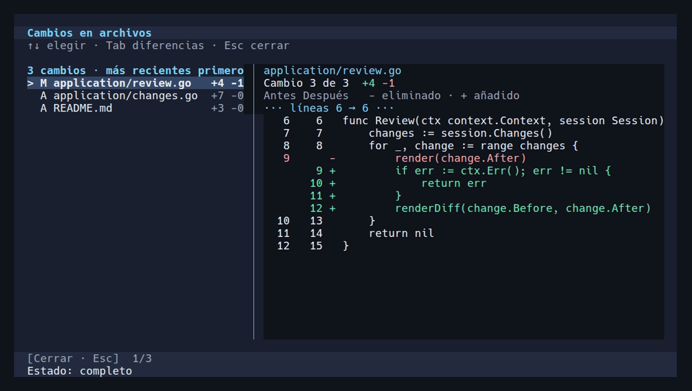

# Interactive console

`axlr-tui` is AXLR's terminal interface. It streams output from OpenRouter or from [local OpenAI-compatible servers](#local-models), lets you review tool calls, and keeps resumable local sessions. [Getting started](getting-started.md) covers the initial build and launch.

## Work in a session

The header shows the model, the workspace with its Git branch, and since 13 October 2026 the session's KMP about, how many memories the store holds under it ("new project" when none) and whether the session's MADE instance is open, then the connected engines; a narrow row drops the memory segment first. Before a session's first prompt, at launch and after `/new`, it shows the engines the launch connected and `MADE instance at the first prompt`; the first turn's catalog then names the session's plugins (until 14 October 2026 neither showed until the first prompt). `/mcp` shows under each engine its store, how it was chosen, the about and the console's work identity (decisions J1 and J2 of the [lifecycle integration design](plans/2026-10-13-lifecycle-integration-design.md)). The console uses the current directory unless `--root` names another existing workspace. Type a prompt and press Enter. Shift+Enter, Ctrl+J or Alt+Enter insert a newline: terminals without the kitty keyboard protocol or xterm's modifyOtherKeys (tmux with `extended-keys off`, VTE terminals) send Shift+Enter as Enter, while Ctrl+J and Alt+Enter reach the console everywhere. Ctrl+G opens the draft in `$VISUAL`, else `$EDITOR`, else `vi` (`notepad` on Windows), and puts what you save back in the composer; quitting the editor with an error leaves the draft as it was. While AXLR is running, sending another message queues it: the transcript shows it as queued and the footer adds “message queued”. The current model step is not interrupted, so a reasoning model keeps its work. When the step ends in tool calls, the queued message joins the running turn after their results and the next model request carries it, marked for the model as sent while it was working, so it answers both; when the step ends in an answer, the queued message starts the next turn. A ceremony step is never joined: the console stops it at its next model request and starts a turn with the message, without reporting that stop as an error. Several messages sent meanwhile are joined. Esc still cancels the running step, and a message still queued comes back to the composer, ahead of anything you were typing, instead of starting the next turn; Enter sends it. While a turn runs the footer says what it is doing with a clock for that phase, which restarts at every request and tool (`Waiting for model · 6s`), followed by the whole turn's (`⏱ 1m42s`, `t` with ASCII icons), which counts from the prompt and keeps counting while an approval card waits. Up and Down in the composer browse only this session's user messages and return to the current draft. The first model choice is made through `/model` or `--model`. Enter in `/model` changes the model of this session only; Ctrl+Enter (or Ctrl+D, for terminals that send Ctrl+Enter as Enter) also saves it as the default for new sessions. The first model chosen while no default is saved becomes the default either way. (Until 12 October 2026 Enter also changed the default, so trying a model for one session changed every later one.)

The model picker filters to text models that support tools. Typing filters by every word, Tab and Shift+Tab change provider, Ctrl+S marks a favorite (kept on top, saved as `favorite_models`, at most 50), arrows and PgUp/PgDn move, Enter selects for this session and Ctrl+Enter also as the default. `:batch` variants, which answer within hours, are not listed unless the session already uses one. A catalog failure offers Retry. A `--model` value bypasses the catalog for that launch. The selected model can change later only when the turn is idle, complete or interrupted without pending tool calls; the transcript remains in the session.

| Control | Action |
|:--|:--|
| `Enter` / `Shift+Enter`, `Ctrl+J`, `Alt+Enter` | Send / insert a newline |
| `Ctrl+G` | Edit the draft in `$VISUAL` or `$EDITOR` |
| `@` | List the workspace's files and directories that match the word after it: names that start with it, then paths that do, then names and paths that contain it, then its letters in order. ↑↓ select, Tab or Enter replaces `@word` with the relative path (the prompt carries the path, not the file; the model reads it with `local_read`), Esc closes the menu for that word and Ctrl+R lists again. See [mention files](#mention-files) |
| `/` | List the commands that match what you typed, up to twelve at a time (fewer on a short screen): those whose name starts with it, then those with an alias that does, then those whose name or alias contains it (`/trab` finds `/jobs` through `/trabajos`). Each row shows the command's aliases dim after its name; ↑↓ scroll the list and select, Tab completes, Enter runs the selected one. A `/word` that names no command is refused with `Unknown command /word` and stays in the composer, also with text after it (`/foo bar`) unless the word is a path, absolute or in the workspace: `/tmp explain this` and `/etc/hosts what is this` are prompts. (Until 14 October 2026 only a lone `/word` was refused, and `/foo bar` went to the model.) |
| `/new` (aliases `/nueva`, `/clear`) | Start an empty session in this workspace with the session's model, in normal mode; the previous one stays in `Ctrl+O`. Refused while a turn or operation runs or a tool call waits for a decision, with the reason in the footer. Also **New session** in the action palette (`N`) and the first row of `Ctrl+O`, which keep the composer's draft |
| `/model` | Choose a model |
| `/normal`, `/review`, `/writer`, `/research` | Choose direct work and its local tool policy (aliases `/revisar`, `/escritor`, `/investigar`) |
| `/stop-ceremony` | Cancel the running ceremony in MADE and return to normal mode (alias `/parar`); see [a step the model will not hand back](ceremonies.md#a-step-the-model-will-not-hand-back) |
| `/plan` (alias `/planificar`) | Open the plans panel: recent plans with their tasks, sync and changed files; `n` arms planning for the next prompt (the brief becomes verified atomic tasks you approve, run by workers) and `r` resumes an interrupted plan. Without MADE plans it arms planning directly. `/plan <goal>` arms planning and sends the goal as the brief in one step (until 14 October 2026 it was refused with `usage: /plan`). See [plans](ceremonies.md#plans-atomic-tasks-for-small-models) |
| `/debug`, `/delivery`, `/incident`, `/repair`, `/improve` (aliases `/depurar`, `/entrega`, `/incidente`, `/reparar`, `/mejorar`) | Select a console-driven MADE procedure for the next prompt; `/incident`, `/repair` and `/improve` also open a pending approval card; `/repair` opens the self-repairs and improvements panel when the agent requested one from this session, and `/improve` does when one of them is an improvement |
| `/jobs` (alias `/trabajos`) | List every repair and improvement of every session and console with its step, pull request and owner; start one from a brief, decide, recover, read its checks and queue green pull requests to merge in order. See [jobs and the merge queue](ceremonies.md#jobs-and-the-merge-queue) |
| `/update` | Install KMP and MADE when they are not connected, and update the local ones that are |
| `/mcp` | Inspect connected MCP servers, tools and approvals |
| `/approvals` | Show saved always-allow tools and autonomy mode |
| `/autonomy on` / `/autonomy off` | Automatically approve permitted known tools, or restore normal policy; `/autonomy` alone shows the current state |
| `/plugin` (alias `/plugins`) | Browse packages installed in AXLR and available sources |
| `/theme` | Preview and save appearance |
| `/changes` / `/diff` / `Ctrl+D` | Review this session's file changes; with a draft in the composer `Ctrl+D` deletes the character after the cursor instead |
| `/undo` (alias `/deshacer`) | Put back every file the last turn changed, or the most recent turn that changed files when the last changed none, after a `y`; see [review file changes](#review-file-changes) |
| `/usage` (alias `/uso`) | Show this session's tokens, cost by provider, latency and budget; see [cost and budget](#cost-and-budget) |
| `/axlr-info` | Play the AXLR emblem the README shows, full screen: the chevrons spring in from the left, each letter drops with a bounce, a light sweeps the letters and the tagline types itself (animated with [harmonica](https://github.com/charmbracelet/harmonica) springs, in half blocks scaled to the screen; letters cream on a dark theme, near black on a light one). Under it: AXLR's version, the installed KMP and MADE versions (`kmp-mcp --version` and `made-mcp --version` of the configured engines, or `not installed`), the session's model and whether it goes through OpenRouter or a local server, and Jev: off, or on with its pinned model and its methods, the `axlr_judge` tool and the final check with its threshold. `r` plays it again; Esc, Enter or `q` close it, and other keys do nothing |
| `Ctrl+P` | Open the action palette; **Continue interrupted turn** and **Cancel turn** are listed only when there is a turn to continue or something to cancel (until 14 October 2026 they were listed on an idle console), and their keys `R` and `C` still say why they do nothing |
| `Ctrl+O` | Open a saved session |
| `Ctrl+F` | Search the current conversation as drawn: the footer counts every occurrence (`2/5`), the current one is marked apart from the others and scrolled into view; Enter or ↓ goes to the next, ↑ or Shift+Enter to the previous, and keys that leave the query as it is keep the place |
| `Ctrl+R` | Explicitly continue an interrupted turn |
| `PgUp` / `PgDn`, mouse wheel | Scroll the conversation. While it is not at its end, a row above the composer says so, `↓ 12 new lines · End`, counting the lines added since it left the end; a click on it, `End` with an empty composer (with a draft End moves its cursor) or `Ctrl+End` go back to the end. Sending or queueing a prompt, and `Ctrl+R`, go back to the end too (until 14 October 2026 they kept the scroll, and the prompt and its cards stayed below the view) |
| `Ctrl+Home` | Go to the start of the conversation |
| `F1` | Show in-app help |
| `Esc` | Drop a selection, close an overlay or cancel the active turn; the footer then says “Cancelled” beside the session state and cost, and the conversation ends with “Cancelled by you” until the next message |
| `Ctrl+C` | Cancel active work; when idle the first press clears a non-empty draft (↑ brings it back) or says “press Ctrl+C again to quit”, and a second press within two seconds quits |
| `/exit` (alias `/quit`) | Quit |
| Drag over the conversation | Select text and copy it on release; double click takes a word, triple click a row, Shift+click extends |
| `/copy` (alias `/copiar`) | Copy the last reply as the model wrote it, or the current selection; `/copy code` copies the last reply's last code block and `/copy 2` its second, without the fences |
| `/export [path]` (alias `/exportar`) | Write the session as Markdown: title, model and dates, each prompt and reply, a row per tool call with its arguments, the console lines and the cost the ledger knows. Without a path it goes to `<workspace>/.axlr/exports/<title>-<yyyymmdd-hhmm>.md` (a second export within the minute adds `-2`); a relative path is the workspace's and `~/` the home directory. An existing file is never replaced. The footer says where it went |
| `/session [export [id]]` (alias `/sesion`) | Alone, the session's MADE instance and the last turn's record. `/session export` writes the open session (or the saved one `id` names) as a bundle, `<workspace>/.axlr/exports/<id>-<yyyymmdd-hhmm>.axlr-session.json`: the transcript, its times, mode and console notes, the title and the about, the MADE instance and where it was exported from. Another console resumes it with `axlr-tui --import <file>` (decision I4 of the [lifecycle integration design](plans/2026-10-13-lifecycle-integration-design.md)): the session is saved there bound to that workspace, its instance continues in a successor that names the imported one as predecessor, and the handoff is recorded under `ws:<id>`; when the bundle came from another workspace, `Ctrl+D` marks the changes made there `other workspace`, names that workspace and refuses to restore them, as `/undo` does (until 14 October 2026 they were listed as this workspace's and the restore failed); a session open in another console of the same state directory is refused in plain words |
| `/memory save` · `/memory compare <about>…` · `/memory forget <ref> [why]` (alias `/memoria`) | The person's memory commands (decisions A4, D7 and E15). `save` exports the project's about as the checkout's bundle `.kmp/memory.jsonl` with `kmp-mcp export`, a live engine does not block it, and git decides whether it travels. `compare` reads `kmp_relate` between the session's about and the ones named, in the session's context, and shows the declared relations, the proposals from shared coordinates and how many entries were read per about; it writes nothing. `forget` closes an entry: an observation under the entry's about that supersedes it, with the reason and the command typed as evidence; the entry stays, superseded, and is never removed. There is no write command and no `/memory view`: nothing reaches the project about without evidence, and KMP's own viewer reads the store |

The interface supports mouse controls where the terminal supplies them. Buttons, footer hints, catalog rows and the file-change list respond to a left click; the wheel scrolls the conversation and every scrolling panel. In a scrolling panel (info, `/usage`, `/session`, the `/mcp` and `/plugins` detail, F1) `Home` and `End`, or `Ctrl+Home` and `Ctrl+End`, go to its start and its end besides PgUp/PgDn (until 14 October 2026 the info panel and the others ignored them). The console keeps mouse reporting on while it runs, so a plain drag is seen by AXLR rather than by the terminal; see [copy and paste](#copy-and-paste). In an approval dialog, inspect the exact target and arguments with arrows, PgUp/PgDn or the wheel. A `local_edit` card shows the file's path and the edit as a diff, the old text as red `-` lines and the new text as green `+` lines, unchanged lines once as context; a `local_write` card shows the path, the mode and the content (its first 400 lines), and over a file that exists in the workspace (up to 64 KiB of text) the diff against it as an edit's card does, after how many lines it adds and removes (`against the file on disk: +1 -1 lines`; until 14 October 2026 a replace listed the whole new file); a `local_exec` card shows the command line as a shell reads it (`$ go vet ./buildinfo/...`), then the working directory, the timeout, the output limit and the standard input only when the call sets them, under a warning when it runs code its arguments hide (standard input, `-c`) or deletes, moves or truncates files (`rm`, `rmdir`, `unlink`, `shred`, `mv`, `truncate`, also behind `sudo` or `env`): `▲ deletes or moves files; /undo cannot restore what a command changes`, which informs and changes no approval rule (until 14 October 2026 such a card looked like any command); a command whose first argument repeats its program (`$ echo echo hola`) is flagged `▲ the first argument repeats the program` (since 14 October 2026); other tools show their arguments as JSON. The card's title names the tool (`local exec`) without the workspace path, which the header shows, and the card grows to 60 % of the screen before its details scroll. Its keys wrap onto more rows when the screen is narrow (until 14 October 2026 they were cut, at 70 columns after `l always allow…`, hiding `d deny` and `esc`). `A` approves once and `D` denies after asking for an optional one-line reason in place of the card's keys: Enter denies with it, and the call's result tells the model `tool call denied by user: <reason>` so it can change course instead of guessing; Esc denies without one; Ctrl+C goes back to the card undecided; when more than one call waits, Shift+A (shown as `A approve all N`) approves the card's call and every call queued behind it, in order, as `A` on each card would, and a call the model adds afterwards gets its own card; `Esc` (or `Ctrl+C`) cancels the turn's pending calls instead of deciding this one, and on a card for an unknown tool `Ctrl+R` rejects it and continues. When offered, `L` executes this call and always allows the exact tool identity on future calls, `F` activates full autonomy and executes this call. On a `local_exec` card `S` executes the call and allows that exact command for the rest of the session: a later call with the same program, arguments, working directory and standard input (the timeout and the output limit aside) runs without a card, also in review, writer and research modes, where `S` is the only allow on offer. It lives in this console's memory only: nothing is saved, another or reopened session asks again, and nothing matches by prefix or by program name, since `git diff --output`, `git -C` and `git -c` can write anywhere. `/approvals` lists saved choices. The autonomy switch approves known tools that the work mode permits; it persists until turned off. Reading the workspace never needs a card: `local_read`, `local_search` and `local_list` run without one with autonomy on or off, since they change nothing; the work mode and a ceremony step's own limits still apply to them first. (On 10 October 2026, with autonomy off, each read of a "where is X" question raised a card.) Writes, edits and commands keep their cards unless autonomy or an always-allow covers them. Restricted modes still require a decision for every local `exec` but the commands allowed with `S`, and a new ceremony check command always needs approval. Their dialogs offer only decisions that apply to that call. Unknown tool names cannot be approved. An ordinary turn is limited to 32 tool calls (`turn_tool_calls` in [settings](#edit-settings-as-json), from 8 to 256); driven ceremonies reset the allowance as a step advances, and under the [compact profile](ceremonies.md#the-compact-profile-for-small-models) a step has 16, or the turn's allowance when that is smaller. When a fifth of the allowance is left, the next request carries one `[AXLR · budget]` note telling the model how many of how many calls remain and that the person's next message starts a new allowance, so it finishes or says what remains instead of being cut mid-work; the note does not restart the allowance. (Without that last part, claude-haiku-5.5 stopped one call into the next turn on 9 October 2026, taking the earlier note for its new allowance.) The system prompt states the allowance from the start (a fixed sentence for the console's setting, so the prompt cache keeps it). An answer with more calls than are left runs the calls that fit, in order, and the rest are answered `not run: over the turn's tool-call budget of N calls: …`, which says how many of the answer's calls ran; the transcript shows them as over budget, not as denied, and they do not count toward the turn's calls. (On 10 October 2026 claude-haiku-5.5 sent 93 `local_read` calls with 31 left, and refusing the whole answer ran none.) A [Jev final check](#jev-an-external-judge-off-by-default) follow-up gets only what the request left. At the limit the turn pauses: send a message or press Ctrl+R to continue with a new allowance. A console-driven ceremony step is continued automatically, twice at most; see [a step the model will not hand back](ceremonies.md#a-step-the-model-will-not-hand-back). Cancellation does not reverse an effect that already happened. A call cancelled while it ran is returned to the model as `tool call cancelled by the person before it finished`, with its effect unknown and the instruction not to run it again unless you ask. (Until 14 October 2026 it read `tool execution failed; effect unknown: context canceled`, and glm-5.3-flash ran it again on the next, unrelated prompt.)

A click on a tool row opens what the call returned under it, and another click folds it; from the keyboard, `Ctrl+P` then `L` (**Last tool result**) opens or folds the last call's and scrolls to its row (until 14 October 2026 only the mouse opened a result): a command's exit code, standard output and standard error as text, a read's text, a write's or edit's diff from the snapshots `/changes` shows, a denied call what the model was told, and any other result as an outline of its JSON with string values unescaped and a multi-line string as a block under its key. It opens the first 200 lines and says that Info (`Ctrl+P` → `I`), which shows every result of the session the same way, has the rest. The Editorial theme sums finished tool runs up in one line, which does not open.

A turn that fails leaves its error in the footer and the same row in the conversation, such as `✗ OpenRouter invalid_request (HTTP 400): anthropic/claude-nonexistent-9 is not a valid model ID · choose a model the provider serves with /model`: the provider's message and, when the error says what to do, a hint (choose a model with `/model`, check `OPENROUTER_API_KEY` or a local server's `api_key_env`, add credits, wait out a rate limit). The row is saved with the session as a console line, never sent to the model, so reopening the session still says why a prompt has no reply. The error sits on up to three rows above the footer's hints and state, which stay: after a failure that left the turn interrupted the hints offer `ctrl+r retry`, and a stream the provider cut reads in the console's language (`OpenRouter cut the reply: it ran past the stream's maximum duration`). (Until 14 October 2026 such an error took the whole footer, hints and state included, as raw `! OpenRouter stream maximum duration exceeded`.) A cancelled turn, the tool-call limit and the budget pause are not failures and leave no row; a message queued during the failed turn starts once the row is saved. (On 12 October 2026 an invalid model id left only `! OpenRouter invalid_request (HTTP 400)` in the footer, and nothing once it moved on.) An error stays in the footer until the next operation, or until a notice or a question displaces it: the panel's `y restores?`, `/undo`'s question, `press Ctrl+C again to quit`. An error that must stay, a reply not yet saved, keeps its row and the notice shows under it. Notices (`Exported to …`, a copy) last until the next key press or ten seconds; `/undo`'s question and the budget warning wait for a key. (Until 14 October 2026 an error hid every later notice, so the second Ctrl+C's warning never showed, and a notice stayed for minutes across turns.)

## Mention files

Type `@` and part of a name to pick a file of the workspace instead of spelling its path. The console walks the workspace in the background the first time `@` opens in a session, depth first and without following links, and keeps the list until a turn ends (which may have written files), the session changes or Ctrl+R in the menu. The walk stops after 20,000 entries, and the menu then says it shows the first ones. It never lists `.git`, `.hg`, `.svn`, `node_modules`, `vendor`, `dist`, `target`, `.venv`, `venv`, `__pycache__`, `.cache`, `.idea`, `.axlr` or `.kernel` (listed until 14 October 2026), nor what the simple patterns of the workspace's root `.gitignore` match: names and globs (`*.log`, `build/`) and paths from the root (`/gen/*.tmp`); negations (`!`), `**` and nested `.gitignore` files are not read. The menu shows up to twelve matches above the composer, like the slash menu; Enter with no match, or right after a bare `@`, sends the prompt as typed, while Tab inserts the selected path.

## Copy and paste

Drag over the conversation to select text: the selection is painted while the button is held and copied when it is released, with a short confirmation in the footer. Double click selects a word, triple click a row, and Shift+click extends the selection to another cell. Esc drops it. The copied text follows the wrapped lines as shown, without the gutter. `/copy` (or **Copy last reply** in the action palette, `Y`) copies the last reply exactly as the model wrote it, including Markdown and code fences, or the selection if one exists. `/copy code` copies the last reply's last fenced code block, and `/copy N` its N-th, without the fences; the footer says which block of how many. A code line too long for the screen wraps under its own indentation inside the block rather than at the conversation's edge, so a drag over it still reads as code.

The console writes the clipboard with the OSC 52 terminal sequence, so copying works over SSH, and mirrors it to the X11 primary selection and to the host clipboard tools (`wl-copy`, `xclip`, `xsel`, `pbcopy`) when they are present. Terminals that refuse OSC 52 by default need it enabled: kitty, foot, WezTerm, Alacritty, iTerm2 and Windows Terminal accept writes, xterm needs `allowWindowOps`, and older VTE terminals (GNOME Terminal, Tilix) ignore them and rely on the host fallback; inside tmux add `set -g set-clipboard on`. The console cannot tell whether the terminal accepted a write.

Hold Shift while dragging to bypass the console and let the terminal select natively (Alt in VS Code on Linux and Windows, Option in some macOS terminals). That selection includes the gutter and wraps lines where the screen wraps them. Paste with the terminal's shortcut (`Ctrl+Shift+V`, `Shift+Insert`, `Cmd+V`) or Shift+middle click; bracketed paste keeps newlines in the composer without sending the message. A paste of more than 20 lines shows in the composer as one token, `[pasted 200 lines · 6.1 KB]`, which you can type around or delete; the prompt sent, and saved, carries the whole text in its place (a token you edit stays as typed). The conversation shows that prompt with the token too, and a click on it opens the full text and folds it again. A prompt of more than 20 lines the console did not see pasted, such as one in a session saved earlier, is shown folded as `[N lines · size]` the same way. Ctrl+G opens the draft with the pastes in full.

## Work modes

Select a mode with its slash command between turns, after choosing a model. The mode is saved with the session and applies to subsequent work; switching while busy or with pending calls is refused. `normal` is the default for a new session.

| Command | Purpose | Local tool policy |
|:--|:--|:--|
| `/normal` | General agentic work | All six local tools, under saved approval policy |
| `/review` | Findings with locations, failure scenarios and evidence | Read, search and list; write/edit hidden and refused; every exec needs approval, or `S` for that exact command |
| `/writer` | Brief, outline, draft, critique and at most two revisions | Write/edit only `.md`, `.mdx`, `.txt`, `.rst` or paths under `docs/`; every exec needs approval |
| `/research` | Recover memory, read primary sources and produce a supported decision | Same document write policy as writer; every exec needs approval |
| `/plan` | Decompose a brief into atomic tasks you approve; workers run them | No edits while planning; workers (`task` sessions) run autonomous local tools within each task's scope; console drives `axlr_plan`, `axlr_task` and `axlr_sync` 1.0 |
| `/debug` | Reproduce, diagnose, repair and integrate | All local tools; console drives MADE `axlr_debug` 2.0 |
| `/delivery` | Brief, build/check and integrate | All local tools; console drives MADE `axlr_delivery` 2.0 |
| `/incident` | Blameless postmortem with review and person's approval | All local tools; model KMP outcome writes refused; console drives MADE `axlr_incident` 1.0 |
| `/repair` | Repair the configured repository in a fresh clone; the console opens, watches and merges the pull request | All local tools; model KMP writes refused; console drives MADE `axlr_repair` 1.0; start it with `axlr-tui --repair "<brief or #issue>"`, or let the agent request it with `axlr_request_repair` from any session |
| `/improve` | Improve the configured repository in a fresh clone against a check that fails first; the console opens and watches the pull request, and the person decides the merge | All local tools; model KMP writes refused; console drives MADE `axlr_improve` 1.0; start it with `axlr-tui --improve "<brief or #issue>"`, or let the agent request it with `axlr_request_improvement` from any session |

`review`, `writer` and `research` refuse any local exec with nonempty `stdin`, including when full autonomy is enabled. Arguments remain visible for per-call review. These restrictions apply to AXLR's local tools: MCP calls retain their own approval policy and may have external side effects. An approved process is not sandboxed by the mode; the optional [exec sandbox](#exec-sandbox) confines every local command whatever the mode.

Direct modes do not start ceremonies. For debug/delivery/incident, [prepare MADE](runbooks/made.md#prepare-the-driven-ceremonies), select the mode, then send the task. AXLR starts and claims the pinned definition; the model performs the work and hands results to `axlr_step_done`. A new debug/delivery check command is approved once, then reused unchanged for repair/build verification. Incident drafts receive a fresh-context review, then the person's approval through the `/incident` card. On `COMPLETED` or `BLOCKED`, the session returns to normal mode. Missing MADE or definitions prevents this start; there is no silent substitute ceremony. [Ceremonies](ceremonies.md) describes the two execution paths and recovery limits.

The local process environment contains only a sanitized absolute `PATH` and the host's `HOME` when it is absolute, so tools find their usual configuration (`~/.gitconfig`, `~/.cargo`, caches). Other shell variables and provider credentials are not inherited by console exec/check commands. A check that works in your login shell may therefore need explicit paths or a workspace script with documented prerequisites.

### Exec sandbox

Without a sandbox a local command runs with your rights: in full autonomy, or in a repair session with `repair.autonomous`, the model's commands can write anywhere in your home directory, read your keys and reach the network. `exec_sandbox` in [settings](#edit-settings-as-json) confines every `local_exec`, and every ceremony check, forge and git command the console runs through the same runtime, under [bubblewrap](https://github.com/containers/bubblewrap) on Linux:

```json
"exec_sandbox": {
  "mode": "auto",
  "network": true,
  "writable": ["/home/you/.cache/go-build", "/home/you/go/pkg/mod"]
}
```

A confined command sees the whole filesystem read-only, a fresh `/dev` and `/proc`, a private `/tmp` that is discarded when it exits, and only the workspace and the `writable` paths (absolute, existing, at most 32) writable. `network: false` gives it a network namespace of its own with nothing in it, which also stops the console's `git push` and `gh` in `/repair` and `/improve`. Its exit status, output capture, timeout and cancellation are those of an unconfined command.

`mode` is `off` (the default), `auto` or `required`. At launch the console looks for `bwrap` and runs one trivial command under it; with `auto` a platform that cannot confine (bubblewrap missing, unprivileged user namespaces refused, macOS or Windows) runs commands unconfined, the launch says why in one line on stderr and the header shows `! sandbox off`, with the reason and the fix in F1 help and Ctrl+P → I; with `required` every local command is refused with that reason instead. Any mode but `off` prints what it got. The default is `off` because a read-only home breaks common checks until their caches are listed: `go test` writes `~/.cache/go-build` and `~/go/pkg/mod`, cargo `~/.cargo`, npm `~/.npm`. A Landlock backend, which needs no user namespace, is not implemented.

## Review file changes

Open `/changes` (or `/diff`, `Ctrl+D`, or **File changes** in the action palette) to review completed local `write` and `edit` calls, newest first. A Changes hint with the number of changed files appears after the first change. The list has one row per file with its net change, from the first step's before to the last step's after; a file written several times expands into its steps (→ or Enter), so each edit remains individually reviewable. The preview shows the exact before and after text, line numbers, three lines of context, and added/removed counts. It works without Git and survives reopening the session, even if the workspace file has since changed.



`u` puts the selected step's file back to what it held before that step (on a file with one step, the file's row will do; a file with several asks for one of its steps with →); the footer of the panel asks first, and `y` restores while any other key keeps the file. `/undo` puts back every file the last turn changed, newest step first, after the same `y` in the footer. When the last turn changed no file, it offers the most recent turn that did and was not undone (`The last turn changed no file: undo turn 3's changes to calc/calc.go, calc_test.go? y restores`), with the same `y` and the same refusal of a file changed since. A step you already restored from the panel counts as undone: `/undo` leaves its file out and puts back what remains, and a turn whose every step you restored is not offered (until 14 October 2026 `/undo` offered such a turn, found the restored file changed and undid nothing at all); the transcript then says `undid turn 3: restored …` (until 14 October 2026 it only said the last turn changed no file). A restore writes through the session's own local tools, so the workspace root and the exec sandbox's rules hold, and it refuses, saying why and changing nothing, when a file no longer holds what the session wrote (an edit by hand, another program) or is not in the workspace (deleted since, or a session imported from another folder), when the step created the file (AXLR does not delete files), or when a snapshot was not kept. It does not change the model's history: the conversation shows it as a console line (`⟲ restored a.go to before the selected step`, `⟲ undid the last turn: restored b.go, a.go`) and Ctrl+D as a step of its own, `restored` or `undone with /undo`, with its diff. Your next prompt carries one `[AXLR · restore]` note that names the files, whether you restored a step or used `/undo` (and which turn `/undo` reached when it was not the last one), and that the files on disk now hold the restored content; a restore made while the turn is interrupted joins the resumed turn as that note when you press Ctrl+R instead (until 14 October 2026 only a new prompt carried it) (shown as `⟲ console · told the model which files you restored`). (Until 14 October 2026 the model was not told: glm-5.3-flash found calc/calc.go "reverted by someone", distrusted its own work and spent a 382k-token debug ceremony investigating.) A second `/undo` with nothing new since says the turn is already undone. Use Up/Down to select a file or step, → and ← to expand and collapse a file's steps, and Tab or Enter to focus the diff. PgUp/PgDn and the wheel scroll; in the diff Left/Right pan long lines; Home/End jump to the beginning/end; `[` and `]` move to the previous or next file while reading. Esc returns to the conversation and preserves the draft. At 90 columns or more the list and diff appear together; narrower terminals switch between them with Tab. File rows and Close also support the mouse.

Previews retain at most 64 KiB and fewer than 2,000 newlines per version. Larger files and unavailable text previews show an explicit notice, without a partial or guessed diff. Failed, denied, cancelled and unchanged edits do not appear. Empty file creation does. File snapshots are stored privately with tool activity, outside the messages sent to the model. Existing sessions without snapshots remain readable; old edits cannot be reconstructed. `exec` commands and MCP/plugin effects do not produce file snapshots.

## Appearance and language

`/theme` offers Auto, Ink, Aurora, Paper, Phosphor and Editorial. Editorial is light and also changes the layout: speaker labels, consecutive tool calls summarised in one line, and the approval as a bottom sheet. Press `I` for Safe, Nerd Mono or ASCII icons; `A` toggles reduced motion; Enter saves. Nerd Mono needs a Nerd Font configured in the terminal. `NO_COLOR=1` disables color.

The input's text, background, placeholder, selection and cursor follow the active theme, including live previews and cancellation. Auto also updates the input after detecting the terminal's background.

English is the default. `--lang es` or `AXLR_LANG=es` changes interface labels only. Prompts, tool results and stored conversation text are not translated.

## Edit settings as JSON

The console reads `$XDG_CONFIG_HOME/axlr/settings.json`, or `$HOME/.config/axlr/settings.json` when `XDG_CONFIG_HOME` is unset. The first-run setup assistant creates it; the [configuration reference](configuration.md) lists every key with its default and limits. Create or edit it with any text editor:

```json
{
  "model": "provider/model",
  "language": "es",
  "theme": "auto",
  "icons": "safe",
  "reduce_motion": false,
  "approvals": {
    "autonomous": false,
    "allowed": []
  },
  "repair": {
    "repository": "underpass-ai/AXLR",
    "directory": "/absolute/repairs",
    "auto_merge": false,
    "watch_minutes": 45,
    "about": "project:AXLR",
    "autonomous": true,
    "max_attempts": 2
  },
  "jobs": {
    "max_active": 2
  },
  "forged_tools": true,
  "notify": "bell",
  "context_tokens": 65536,
  "max_session_usd": 5,
  "models": {
    "z-ai/glm-5.3-flash": {
      "provider": {"sort": "throughput"}
    }
  },
  "local_models": [
    {
      "id": "local/qwen3.8-27b",
      "name": "Qwen3.8-27B (llama.cpp)",
      "url": "http://127.0.0.1:8080/v1",
      "context_tokens": 65536
    },
    {
      "id": "local/gemma-4-31b",
      "name": "Gemma 4 31B (vLLM)",
      "url": "http://127.0.0.1:8082/v1",
      "model": "gemma-4-31b",
      "context_tokens": 65536
    }
  ]
}
```

All keys are optional. `repair` configures `/repair`, the agent's self-repair and `/improve`: `repository` is the `owner/name` the console may repair (default `underpass-ai/AXLR`), `directory` where it clones (default `<data>/axlr/repairs`), `auto_merge` whether green pull requests merge without the person (default `false`), `watch_minutes` how long one check round may take (default 45), `about` the KMP project scope (default `project:<name>`), `autonomous` whether an agent-requested repair session runs local tools in its clone without a card (default `true`; reads never need one; the reproduction command and the merge always wait for the person) `max_attempts` how many repair sessions one failure may start (default 2, at most 5) and `install` whether a merged repair's rebuilt `axlr-tui` replaces the running console's executable without the panel's `i` (default `false`; see [updating the runtime](ceremonies.md#self-repair-from-a-running-session)). `/improve` uses `repository`, `directory`, `watch_minutes` and `about`; `auto_merge` never applies to an improvement, whose merge always waits for the person. See [ceremonies](ceremonies.md#self-repair-the-console-drives-the-pull-request) and [self-repair from a running session](ceremonies.md#self-repair-from-a-running-session). `model` may be empty to choose a model in the console. `language` accepts `en` or `es`; `theme` accepts `auto`, `ink`, `aurora`, `paper`, `phosphor` or `editorial`; `icons` accepts `safe`, `nerd-mono` or `ascii`. In `approvals`, `autonomous` enables automatic approval for every known tool; `allowed` contains exact tool identities saved by the approval dialog. Edits take effect on the next launch. `--model` overrides the JSON model for one launch; `--lang` overrides `AXLR_LANG`, which overrides the JSON language. Saving a default in `/model` (Ctrl+Enter), saving `/theme`, or changing `/autonomy` or always-allow choices updates the corresponding JSON keys while retaining other settings, including keys from newer AXLR versions. The console writes the file with owner-only permissions and rejects invalid JSON without replacing it.

`prompt_tokens` (the prompt a request to a model without a known window may reach; default 64,000, at least 16,384) is described under [model context](#model-context), `max_session_usd` (default 0, no limit) under [cost and budget](#cost-and-budget), `context_tokens` and `local_models` under [local models](#local-models), `models` under [per-model request options](#per-model-request-options), `jev` under [Jev](#jev-an-external-judge-off-by-default), and `ceremonies.profile` (`auto`, `standard` or `compact`) under [the compact profile](ceremonies.md#the-compact-profile-for-small-models), `trace_retention_days` (default 30; `0` keeps every trace) and `trace_payloads` (default `false`) under [diagnostics and privacy](#diagnostics-and-privacy). `exec_sandbox` is described under [exec sandbox](#exec-sandbox). `engines.shared` is described under [shared engines](#shared-engines). `turn_tool_calls` is a turn's tool-call allowance (default 32, from 8 to 256; see [work in a session](#work-in-a-session)). `plan.model` names the model that decomposes a brief (default `session`, the session's model) and `plan.auto_approve` starts a verified plan without the person (default `false`); see [plans](ceremonies.md#plans-atomic-tasks-for-small-models). `jobs.max_active` bounds the repair and improvement sessions active at once across the consoles that share `<state>/axlr/repairs.json`, whether the agent or the person started them (default 2, from 1 to 8); see [jobs and the merge queue](ceremonies.md#jobs-and-the-merge-queue). `forged_tools` (default `true`) offers the model [forged tools](#forged-tools). `reviewer_model` names the model of the fresh-context review of an `/incident` postmortem (empty: the session's model). `favorite_models` holds the models marked with Ctrl+S in `/model`; it is read again each time `/model` opens. `notify` is how the console calls you back when it needs you: `bell` (the default) rings the terminal's bell, `osc` also sends an OSC 9 desktop notification (iTerm2, kitty, WezTerm, Windows Terminal, ConEmu; inside tmux it needs `allow-passthrough`), and `off` stays silent. It rings when a turn that took ten seconds or more ends (not when you cancelled it) and whenever an approval card or a plan, postmortem or repair card appears. Whatever the setting, unless `TERM` is `dumb`, the console keeps the terminal's title at `AXLR · <state> · <session>`, the state being `ready`, `working`, `waiting for you` or `error` and the session its title or first prompt, and on quitting it puts back the title it found (through xterm's title stack; a terminal without one is left with an empty title).

Existing `model-preference.json` and `ui-preference.json` files under the state directory are read until `settings.json` exists. Existing `approvals.json` choices are read until `settings.json` has an `approvals` section. The next related change writes those values into `settings.json`; the old files are left in place. MCP server connections and their own approval policies remain in the separate `$XDG_CONFIG_HOME/axlr/mcp.json` file.

## Model context

The private session store retains the full transcript. Since 13 October 2026 a request's whole context (guidance, tool schemas and messages) is bounded in tokens (decision D10 of the [lifecycle integration design](plans/2026-10-13-lifecycle-integration-design.md)): the console counts it with one tokenizer for every model (tiktoken's `o200k`, each message counted once), scaled by what the provider reported for the model's earlier requests (on 13 October claude-haiku-5.5 billed 27K prompt tokens where `o200k` counted 9.4K of Spanish text; the factor starts at 1 and follows the reports, between 1 and 4), and keeps it under `prompt_tokens` (default 75,000) for a remote model, or three quarters of the window for a local one. Under the cap nothing is dropped and no checkpoint is written, so the provider's prompt cache keeps its prefix. A request that would exceed the cap stops the turn: the session's MADE instance closes (`continued at N tokens`), a successor session opens with the same workspace, model, mode and about, titled after the predecessor with "(2)", and the person's prompt is sent there with a recall note that wakes the project's about, the person's and `ws:<predecessor>`; the footer says so and the previous session stays readable in the picker. A prompt that exceeds the cap on its own is refused with the cap's name, not continued. The per-result bounds below still apply, derived from the same `prompt_tokens`.

The byte budget remains the measure when the tokenizer is unavailable: four limits in bytes, not the model's advertised token window, a message-history ceiling, a low watermark the history is cut back to once it crosses the ceiling, a limit per tool result and an extractive checkpoint. Which limits apply depends on what the console knows about the model:

- A model whose window is unknown, which is every OpenRouter model, gets the **prompt budget**: `prompt_tokens` in [settings](#edit-settings-as-json) (default 75,000; the figures below are for 64,000) is the prompt a request may reach. At the 2.44 bytes per token measured on Claude Haiku 5.5, minus 17 KiB for the guidance and the tool schemas, that is a 138,752-byte ceiling, a 69,376-byte low watermark, 17,344 bytes per tool result and an 11,562-byte checkpoint. The default stays under the 100K prompt tokens above which Haiku 5.5 costs five times as much; a session of 198 requests that reached 315K tokens per request and $14.13 in total under the earlier 1 MiB ceiling replays at 62K tokens at most and $0.90 under this budget ([research](research/2026-10-08-bounded-remote-context.md)). The budget applies to every remote model, the plan model included; raise `prompt_tokens` for a cheaper model with a larger window, and a global `context_tokens` smaller than the prompt budget still bounds it. Tokenizers differ: z-ai/glm-5.3-flash held about 4.2 bytes per prompt token on 8 October 2026, so at 2.44 its requests stopped near 37K tokens. The console therefore measures each remote request, the size of the body it sent against the prompt tokens the provider counted, and keeps a moving average per model (each ratio clamped to 1.5–6 bytes; prompts under 2,048 tokens are not measured; past 50 requests a new one weighs a fiftieth) in `bytes-per-token.json` under the state directory, shared by every console. After five measured requests the model's prompt budget uses its own ratio: 251,392 bytes of history for glm-5.3-flash at 4.2, which brings its requests to the 64,000 tokens the budget aims at. A console fixes the ratio it applies to a model the first time it uses it, the 2.44 default included when the model had fewer than five measured requests then, so the ceiling does not move under a running session; the next launch picks up what was measured since. Local models keep the window budget.
- A [local model](#local-models) gets the **window budget**, since its server holds the window for free: three quarters of its window at three bytes per token (147,456 bytes for 65,536 tokens), a low watermark three quarters of the ceiling, a tool result at most an eighth of the ceiling and the checkpoint at most an eighth of the low watermark. A window that holds more than the 1 MiB ceiling keeps the ceiling: 1 MiB, 768 KiB, 64 KiB per tool result and a 16 KiB checkpoint.

Without the tokenizer, when the history crosses the ceiling, whole earlier turns are dropped until it is back under the low watermark, and one checkpoint message takes their place. It quotes each omitted request of the person exactly, newest first (an excerpt when they no longer fit), and next to each the files the turn wrote, which are on disk, and the memory it recorded in KMP (`about` and `idempotency_key` of each accepted `kmp_write_memory`); a turn that wrote a file or ran a command in a session that uses KMP, and recorded nothing, is marked `unrecorded`. Console messages (`[AXLR…]`) belong to the request before them. The checkpoint keeps the KMP agent and context identities and the index of the last guide and protocol result, and tells the model to recover what the session settled with `axlr_recall`, a file from disk and one exact message with `axlr_history`. When the map no longer fits, older turns keep only their request and `records_omitted_at_or_before` says from which one. The checkpoint quotes no assistant prose.

In a closed turn, the arguments of a `local_write` or `local_edit` call of 512 bytes or more keep only their path and mode; the written text, the digest and the why are replaced by one `"[omitted]"` record, which no tool takes as a parameter, with the size of each text (`content_bytes`, `old_text_bytes`, `new_text_bytes`) and a note to `local_read` the file, since the file on disk holds it, and that a new call needs its full text. (Until 14 October 2026 the sizes were `content_omitted_bytes` and the note `recover`, next to the call's other arguments, and glm-5.3-flash sent that shape back as a `local_write` with no content, twice.) The saved transcript keeps them whole. Only completed calls are shortened; denied or failed ones stay whole. The turn in progress keeps them exact unless it alone exceeds the budget, when its own completed writes are shortened the same way, with the same note.

In a closed turn, an `axlr_tools` result of 512 bytes or more that returned one exact schema (called with `name`) is replaced by its name and one `"[omitted]"` record with its size (`schema_bytes`) and a note to ask for it again (until 14 October 2026 a flat `schema_omitted_bytes` and `recover`, the shape shortened writes left behind): the model read it to make a call that is done. Searches and listings stay, and the turn in progress keeps the schema. Host results such as exact tool-discovery schemas are retained up to 64 KiB, and `axlr_history` pages hold up to 32 KiB, or what the model's budget keeps per tool result when that is less, so a recovered page is never excerpted again.

A `local_read` page is bounded the same way: without `max_bytes`, or with a larger one, it holds what the budget keeps per tool result less 512 bytes for the result's offsets, status and digest (16,832 bytes under the default prompt budget), and a page whose JSON escaping (newlines, quotes, `<`, `>`, `&`) still overflows the budget is read again, shorter, until it fits. Its `next_offset_bytes` is therefore where the file continues. Under the default prompt budget, a 30 KB `docs/console.md` read without `max_bytes` used to come back as an excerpt whose `next_offset_bytes` was the end of the file; the model then tried a `query` field `local_read` does not have and re-read overlapping ranges. A `local_read` result excerpted all the same, such as one saved under a larger budget, names the offset of the first byte its excerpt omits and the largest `max_bytes` to read it with, and says that its `next_offset_bytes` follows the whole page; other excerpts suggest a narrower query, filter or page.

### Per-model request options

`models` in [settings](#edit-settings-as-json) adds fields to the requests OpenRouter receives for one model. The key is the exact model id a request names, suffix included: an entry for `z-ai/glm-5.3-flash` does not apply to `z-ai/glm-5.3-flash:nitro`. The entry applies to every request for that model, the session's, a plan's, its workers' and the reviewer's. Without an entry, the default, a request carries none of these fields and OpenRouter chooses the endpoint and the defaults. An entry may hold:

| Key | Meaning |
|:--|:--|
| `provider` | OpenRouter's [provider routing](https://openrouter.ai/docs/features/provider-routing), sent as written: `order`, `only` and `ignore` (lists of provider slugs), `allow_fallbacks` (OpenRouter's default `true`), `require_parameters`, `data_collection` (`allow` or `deny`), `zdr`, `quantizations`, `sort` (`price`, `throughput` or `latency`, or an object with `by` and `partition`), `preferred_min_throughput` (tokens per second) and `preferred_max_latency` (seconds) as numbers, and `max_price` with `prompt`, `completion`, `request` and `image` (dollars; per million tokens for `prompt` and `completion`) |
| `reasoning` | OpenRouter's [reasoning](https://openrouter.ai/docs/use-cases/reasoning-tokens) object: `effort` (`max`, `xhigh`, `high`, `medium`, `low`, `minimal` or `none`) or `max_tokens`, not both, plus `exclude` and `enabled` |
| `max_tokens` | Caps the completion, from 1 to 1,000,000 tokens |

The console refuses to launch with an entry that has an unknown key (a misspelt one would otherwise leave the routing as it was), a value of the wrong type or outside these values, or that names a model of `local_models`: local servers receive none of these fields, and their own keys are under [local models](#local-models).

The levers on an endpoint's price and speed are `provider.sort: "throughput"`, `provider.max_price.completion`, `provider.ignore` and the `:nitro` suffix. On 8 October 2026 OpenRouter routed `z-ai/glm-5.3-flash`, requested without preferences, to OpenInference: $0.032 per million input tokens, $3.109 per million output tokens, about 10 seconds to the first byte and about 19 tokens per second. Relace and InferenceNet served the same model at $0.50 per million output tokens, 1 to 2 seconds to the first byte and 78 to 177 tokens per second. Output was 75 % of that session's cost, and their endpoints would have cut the session's cost by about 59 %. `z-ai/glm-5.3-flash:nitro`, which sorts by throughput, went to InferenceNet: about 1.1 seconds to the first byte and 120 to 180 tokens per second. `"provider": {"sort": "throughput"}` asks for the same order under the plain id. `"max_price": {"completion": 1}` holds out endpoints whose output costs more than $1 per million tokens, a ceiling that would have held out the $3.109 of 8 October but not the $0.937 OpenInference listed on 9 October; `ignore` holds out providers by the slug OpenRouter lists them under. A ceiling or an exclusion that leaves no endpoint leaves OpenRouter nothing to route to.

`sort: "price"` is accepted but is not the lever it seems: OpenRouter does not document which price it sorts by (checked on 9 October 2026), and the endpoint list of the model is ordered by input price, where OpenInference, the cheapest input, comes first. An order weighted by input price would choose the endpoint of the case above. No sort orders by output price; `max_price.completion` is the only control over it, as a ceiling.

### Prompt caching

A request to an `anthropic/*` model through OpenRouter asks for Anthropic's prompt cache, which OpenRouter forwards to Anthropic, Claude Platform on AWS, Bedrock and Vertex: a top-level `cache_control` places the automatic breakpoint on the last block of the conversation and moves it forward as the conversation grows, and an explicit breakpoint on the system prompt keeps the fixed prefix (schemas and guidance) readable after a cut of the history, which rewrites everything behind the checkpoint. A cached prefix is read at a tenth of the input price and written at 1.25 times it; the entry lives five minutes and every request renews it, and a prefix under 512 tokens is not cached. The projection keeps the prefix stable between requests: a clipped tool result reads the same before and after its turn closes, and the history is cut only when it crosses the ceiling. The `provider_done` trace event reports `prompt_tokens`, `completion_tokens`, `cached_tokens` and `cache_write_tokens`, and the footer shows the cached share of the last request's prompt next to its tokens. Other models and local servers receive the request unchanged. Replaying the session of the [research note](research/2026-10-08-bounded-remote-context.md) with the prompt budget and this cache gives 87 % of prompt tokens read from the cache and $0.28 instead of $0.90.

When the active turn alone exceeds the budget, AXLR progressively reduces its tool-result excerpts to 8, 4, 2 and then 1 KiB. It asks the model to finish from the evidence already gathered. The current prompt is not shortened, and tool arguments only as described for completed writes above, with a note; context that still cannot fit produces an explicit error. Full saved results remain intact. `axlr_history` can recover earlier-turn messages, but refuses tool results from the current turn to avoid a rereading loop.

The model normally sees six local tools (`local_read`, `local_write`, `local_edit`, `local_exec`, `local_search` and `local_list`) plus `axlr_tools` (exact plugin schema discovery), `axlr_call_tool` (registered plugin invocation), `axlr_history` (paged saved messages), `axlr_skill` (paged skill resources), `axlr_session` (current-session title and exact memory scope), `axlr_remember` (one KMP memory in one call, when KMP is connected; see [memory writes](#memory-writes)), `axlr_request_repair` (ask the console to repair a defect of AXLR in a separate session, with evidence the console validates), `axlr_request_improvement` (ask it to improve AXLR the same way, citing at least two calls that show the friction) and `axlr_repair_status` (the repairs and improvements linked to the session), `axlr_forge_tool`, `axlr_run_tool` and `axlr_remove_tool` (tools the model writes, runs and uninstalls in the same session; see [forged tools](#forged-tools)), `axlr_logs` (the end of the console's own [app log](#app-log)), plus `axlr_judge` when [Jev](#jev-an-external-judge-off-by-default) is enabled. Session bookkeeping, reading the app log and repair and improvement requests run without a separate approval, because the request itself starts nothing the person has not agreed to; plugin calls retain their configured policy. Review mode hides local write/edit; an active driven ceremony adds `axlr_step_done`; a repair or improvement session never sees `axlr_request_repair`, and repair, improvement, plan and task sessions never see `axlr_request_improvement`. Plugin arguments are validated against the discovered schema before execution; `x-*` keywords are treated as annotations. `axlr_tools` returns a schema without its `x-*` annotations; a schema that still does not fit one host result comes back as an outline of paths and sizes, and `path` (a JSON pointer such as `/properties/stages`) returns that part exactly, including an annotation such as `/x-made-pattern-catalog`. Read only the required schema and follow resource page cursors. [Context policy research](research/2026-09-30-context-policy.md) records the original design; [the audit](documentation-audit.md) covers the later active-turn compaction change.

### Cost and budget

The footer adds the cost of the turn and of the session to the tokens: `27k/64k tok · 87% cache · $0.0031 turn · $0.21 session`, with up to four decimals below a dollar and two from a dollar on. The tokens are the last request's prompt against the prompt the console lets a request reach (the [prompt budget](#model-context), or a local model's window, within `context_tokens`). Each finished turn ends in the conversation with a dim line of what it cost and the tokens its requests used, prompts and completions together (`· $0.0046 · 27k tok`; the cost is left out when no request reported one), and `/usage` lists the last ten turns with the time each began and its prompt's first words, then their requests, tokens, cost and time (`15:46 · arregla el bug de la… · 8 requests · 100k tok · $0.0027 · 2m45s`; until 14 October 2026 a line showed the turn's end time and no prompt). The ledger keeps totals, not requests, so these come from its difference between the prompt and the turn's end in this console: a reopened session shows them only for the turns run since. When the row is narrow, the key hints go first, then the tokens and cache, then the turn's cost; the state and the session's cost stay. The header opens with the AXLR logo, each letter on a tile of its [wordmark colour](brand.md) (copper, gold, brown, sand) in every theme; with `NO_COLOR` or `TERM=dumb` it is written `>> AXLR`. The header writes the workspace from the home directory (`~/…`) followed by its Git branch, `⎇ main*` (`git:` with ASCII icons), with `*` when tracked files differ from it; it reads the branch from the repository's `HEAD` at launch and after each turn and asks `git status` for the marker in the background, without taking Git's lock and without running a repository's fsmonitor hook, so a workspace outside Git, or without `git`, shows no branch or no marker. The model and the workspace are labelled `model:` and `workspace:` (`modelo:` and `espacio de trabajo:` in Spanish). When the row is short the header keeps the path's last two segments, then its last one (`…/scratchpad/ws`), then drops the labels, and only then cuts the names of the connected plugins. The cost is what OpenRouter reports in the usage of every request (`usage.cost`, in dollars). With your own provider key (BYOK) that cost is only OpenRouter's fee, and the console adds `cost_details.upstream_inference_cost`, what the provider billed to the key. Local servers report tokens without a cost: their requests show no cost rather than $0 and never count towards the budget. The turn is what the requests since your last prompt cost; the session's total survives a restart. A request you cancel (Esc), or one that fails or times out, still counts: it adds a request and its time, and when it ended without a usage report after the provider may have started billing it (it streamed something, or it was cancelled or timed out once sent) it is an **unmetered** request, whose prompt tokens are estimated from the size of the body sent at the model's measured bytes per token (2.44 by default) and completion tokens from the bytes it streamed. Its cost is unknown, so it is not in the total nor in the budget; the footer adds `+2 unmetered` after the session's cost and `/usage` counts them under the requests, so you know the total is short. A request the provider refused before answering, such as a wrong model id, adds a request and nothing more. On 8 October 2026 a 198-request Claude Haiku session reached $14.13 while the footer showed only tokens.

`/usage` (alias `/uso`, or **Usage and cost** in the action palette, `$`) shows the session's account: requests, the unmetered ones, prompt tokens with those read from and written to the prompt cache, completion and reasoning tokens, the cost in total and by provider (the upstream OpenRouter routed to, most expensive first; a server that names none, such as a local one, is listed by its model), the average and longest time to the first byte (the provider's first activity or text) and to the end of a request, the budget with what is left, and the last turns run in this console. Esc closes it.

`max_session_usd` in [settings](#edit-settings-as-json) is a budget per session, in dollars, from 0 (the default, no limit) to 10,000. The request that takes the session's known cost past 80 % of it shows a notice in the footer once, until the next key press. When the cost reaches it, the console sends no further request: the turn stops as interrupted with the prompt kept, and the footer says how to go on. Raise `max_session_usd` in settings.json for later launches, or, once the session has passed 80 % of it, press `+` in `/usage`, which allows another `max_session_usd` for this session alone, then `Ctrl+R` continues. A request already running finishes, so the cost can pass the limit by one request. Each session keeps its own account: repair, improvement and plan worker sessions count their requests against their own `max_session_usd`, and their cost is not added to the session that started them.

The account lives in `<id>.usage.json` beside the session's snapshot, a private file (`0600`) replaced atomically: totals, subtotals for at most 16 providers (later ones share `other`) and latency counts, sums and maxima, never a list of requests. A damaged file starts again from zero; one that cannot be read at all (permissions, a disk error) refuses the session's requests while `max_session_usd` is set, since the limit cannot be kept. The `provider_done` trace event also reports `reasoning_tokens` and `cost_usd`.

### The why of each side effect

Every `local_write`, `local_edit`, `local_exec`, `axlr_call_tool` and `axlr_run_tool` call carries `why`: one sentence, at most 240 characters, saying what the call is for, in the person's language (the system prompt names the console's language for it: until 14 October 2026 a Spanish console's cards read `por qué: run the tests`). The console refuses a call without it (`give why: one sentence saying what this call is for`) before any card, and the model sends it again with one; the approval card shows it first, under the command line of an exec card or above the path of a write or edit card; and the turn's record keeps it (see [the session ceremony](ceremonies.md#the-session-ceremony)). Reads need none: `local_read`, `local_search` and `local_list` accept a `why` and ignore it, and the console's own host tools drop one, since a model told to give its side effects a reason gives one to everything (claude-haiku-5.5, 13 October 2026). The runtime never sees the field: the console strips it before the call, and the service's API keeps the plain schemas. `/session` (alias `/sesion`) shows the session's MADE instance and the last turn's record, action by action.

### Memory writes

When KMP is connected with `kmp_write_memory`, the model also gets `axlr_remember`, and the normal-mode prompt tells it to record what a task settles (a decision, constraint, fix or outcome worth reusing) with it before its final answer, silently: the answer never says what was recorded or that nothing was, nor that the session got a title (on 14 October 2026 glm-5.3-flash closed replies with "no grabo nada" and "pongo título a la sesión"). One call carries `kind`, `text`, `summary_en` (the text in plain English with identifiers kept verbatim, asked for with every text since 14 October 2026, when every memory of a Spanish session came without it and a strict store refused each one; the schema cannot require it, since a continuation is sent alone), `evidence` (one string with one to eight items, one per line, each at most 1000 characters; an array of strings is still accepted) and up to eight `links` to refs the model saw (`ref`, `rel` and `why`); the console writes it with `kmp_write_memory` under the session's about (or the `about` given), labels it with the session and the workspace, and derives the idempotency key from the about, the kind and the text, so a retry never writes it twice. `evidence` was an array until 10 October 2026, when claude-haiku-5.5's first call wrote it as repeated `"evidence"` keys with unquoted text, twice out of two, and each memory write cost an extra request; the tool description now carries an example call. It needs no `kmp_guide` and no schema read: on 8 October 2026 recording one memory and one relation took 18 requests (`kmp_guide`, five `kmp_inspect` reads of 23.6 KB, four writes answered `needs_review`). A write with links is KMP's review case: nothing is written, the answer lists the links, at most eight items of the stored context they touch (each cut to 300 bytes) and a `continuation`, and the model commits it by calling `axlr_remember` with only that continuation, or corrects the links. The answer of a write is the stored `ref`, the about and the key; KMP's refusals come back with its code and message. Two refusals never reach KMP or the model: a `kind` outside the schema's list is refused before KMP is called, with the kinds it takes, and when a strict store refuses `summary_en` because it `drops identifiers the text carries: …`, the console copies the listed identifiers into `summary_en` as KMP wrote them and writes once more, so the call is still one. (Until 14 October 2026 glm-5.3-flash's `kind: "fix"` came back as `invalid kmp_write_memory kind`, and a dropped-identifiers refusal cost the model a second call.) `axlr_remember` is refused and approved exactly where `kmp_write_memory` is: the modes and ceremonies that refuse the model's memory writes do not offer it, and it runs without a card only when the approval policy would run `kmp_write_memory` without one. A store whose guide was never synced still accepts these writes; when `kmp_guide` reports the missing guide, its answer names `kmp-mcp guide sync --plugin-root` with the directory of the KMP engine AXLR installed (see the [KMP runbook](runbooks/kmp.md#verify-guide-and-store-selection)).

The console then checks each request: one that changed a file (a `local_write` or `local_edit` whose result completed; a denied, cancelled or failed one does not count) or ran a command (a `local_exec` or a forged tool whose result says it ran, since a check or a test can settle an outcome; a denied, cancelled or refused one does not count, and `local_read`, `local_search`, `local_list`, `axlr_recall`, session bookkeeping and KMP reads never do), ran no ceremony and attempted no `axlr_remember` or `kmp_write_memory` gets one visible `[AXLR · memory]` message, and the model records the result or says in one sentence why there is nothing durable. The message is the console's, not the person's: the conversation shows it as the console line “◇ console: asked the model to record memory”, not as a prompt of yours. A final answer that already says what it recorded or that it recorded nothing (a sentence that names KMP, memory or durability together with a recording verb, in English or Spanish: "I did not record anything in KMP", "I didn't write a KMP memory", "no he registrado nada en KMP", "lo guardé en KMP"; code identifiers such as `kmp_write_memory` do not count) is not reminded: on 10 October 2026 claude-haiku-5.5 was reminded after saying it recorded nothing and then recorded a low-value memory. A request is reminded at most once; Jev's final check still runs at most once per request and always judges the person's request, not a console message. Modes that refuse the model's memory writes, and driven ceremonies, whose outcome the console records, get neither the sentence nor the reminder. See the [KMP runbook](runbooks/kmp.md#what-the-model-sees) for the approval policy of the writes.

### Forged tools

When no local, host, plugin or forged tool does what a task needs, the model can write one and use it at once, in the same session and without restarting the console. `axlr_forge_tool` takes a `name`, a `description`, the `input_schema` of its arguments, a `program` on `PATH` (`python3`, `bash`, `node`…), its literal `args` and one to eight `files` (each path relative to the tool's directory, or its workspace path `.axlr/tools/<name>/<file>`); the console writes them to `.axlr/tools/<name>/` in the workspace and records the tool, with the SHA-256 of each file, in a private registry for that workspace under `<state>/axlr/forged-tools/`. `axlr_run_tool` then runs it by name: the arguments are validated against the schema, passed as one JSON object on stdin, and the result is the `local_exec` envelope (exit code, stdout, stderr). `axlr_tools` lists forged tools beside the plugin ones, marked `forged`, and returns a forged tool's schema, command and files by exact name, so the model looks for one before writing it. A search returns the tools that match every term; when none does, it returns those that match some, most terms first, marked `partial`. To fix a tool the model forges it again under the same name, which replaces its directory. `axlr_remove_tool` uninstalls one by name: it deletes `.axlr/tools/<name>/` and unregisters it, also when its files are already gone or changed; deleting the files another way leaves the tool registered and broken, and a directory under `.axlr/tools/` that is not registered is not its to delete. Forged tools stay registered for later sessions in the same workspace on this machine. The files can be committed, but the registration does not travel with them: someone else's console runs them only after its model forges them again, on that person's card. Add `.axlr/tools/` to `.gitignore` to keep them local.

The guardrails are the console's:

- **Registration.** Only `axlr_forge_tool` registers a tool, in this console's state. A file written into `.axlr/tools/` another way, or brought by a checkout, is never a tool. A tool whose files changed since it was forged here (a `local_edit`, an editor, a `git pull`) is refused until it is forged again, so a run executes the files the forge card showed. `args` must name one of the tool's own files; anything else in the command, such as an interpreter's `-c` or `-e`, is on the forge card too.
- **Approval.** `axlr_forge_tool` and `axlr_remove_tool` are approved and judged as `local_write` and `axlr_run_tool` as `local_exec`, and autonomy and a saved always-allow for `local_write` or `local_exec` apply to them as to those tools; their cards do not offer always-allow, since a host tool has no rule of its own. The forge card shows the command, the description, the schema and each file as code; a run card shows the tool's name and arguments, and approving it runs the command that was registered (`axlr_tools` with the tool's `name` shows it again). The forged files do not appear under [review file changes](#review-file-changes). Modes: review mode runs forged tools but never forges or removes one, writer, research and the other restricted modes refuse forging and removing and ask for every run.
- **Confinement.** A forged tool is a program run by `local_exec`: the workspace as working directory, `PATH` and `HOME` as its only environment, the runtime's timeout and output limit, and the [exec sandbox](#exec-sandbox) when it is on. Without the sandbox a forged tool has the person's rights, like any command they approve.
- **Scope.** Ordinary sessions only: a ceremony, a repair, an improvement, a plan or a task keeps its own tools. A forged tool's failure is the tool's, never evidence for `axlr_request_repair`. The fixed definitions of the three tools keep the request prefix, so forging a tool does not break the [prompt cache](#prompt-caching).
- **Bounds.** Names are 2-48 lowercase letters, digits or underscores, starting with a letter; each file up to 64 KiB and 256 KiB in all; arguments up to 64 KiB; at most 64 tools per workspace.

Set `forged_tools` to `false` in [settings](#edit-settings-as-json) to offer none of the three tools. Sub-agents the model defines at runtime are not part of this; see [the design](plans/2026-10-09-forged-tools-design.md).

### Search and list the workspace

`local_search` and `local_list` let the model look through the workspace without a command. On 9 October 2026, `/improve` runs with Claude Haiku 5.5 made dozens of `local_exec` calls to `grep`, `sed` and `find`, each needing an approval in the restricted modes and returning unstructured text, and reached the 32-call turn limit three times. Both run in AXLR's runtime under the same approval policy as `local_read`; every work mode allows them as it allows reading, and they do not count toward the memory reminder.

`local_search` matches a Go RE2 `pattern` (plain text with `literal`, case-insensitive with `ignore_case`) line by line and returns each matching line's `path`, `line`, byte `column` and `text`, with up to five `context_lines` before and after it. `glob` filters files: `*.go` matches the name at any depth, `tui/*.go` the workspace path and `**/cmd/*.go` the path below any directory. `local_list` returns each entry's `path`, `type` (`file`, `dir`, `symlink` or `other`) and a file's `size`, down to `max_depth` levels (default 3, at most 8) when `recursive`.

Both walk the workspace through the same root as the other local tools, depth first in name order; they never follow a symlink (`local_list` lists it as one) and never enter `.git`, `.axlr` or `.kernel` below the scope (a `path` that points into one of them is searched, as the caller asked; `local_list` lists `.git` without entering it and leaves `.axlr` and `.kernel` out of a listing of their parent, since 14 October 2026, when a top-level listing showed `.kernel/` and the model offered to explore the KMP store). (Until 14 October 2026 they entered the console's own `.axlr` and `.kernel`: a search for `func` filled its page with a 544 KB session export and a recursive listing ran out before `calc/`.) A search skips, and counts in `files_skipped`, a file over 1 MiB, one with a NUL byte in its first 8 KiB and one that is not UTF-8, and cuts a line longer than 300 bytes around its match. A walk stops after 20,000 files or 64 MiB read, a listing after 20,000 entries, with `limit_reached`: narrow `path` or `glob` then. `.gitignore` is not read, so build output and vendored trees are searched unless `path` or `glob` leaves them out.

A page holds at most `max_results` matches (default 50, at most 200) or `max_entries` entries (default 200, at most 500), and, like a `local_read` page, what the budget keeps per tool result: the console asks the runtime for that many bytes with `max_bytes`, and again, shorter, when the escaped result still overflows, so the page reaches the model whole and `next_offset` is where the results continue. While `next_offset` is present the model repeats the call with `offset: next_offset`. Under the default prompt budget, a search of 400 matching lines of about 90 bytes with two context lines each returns 22 matches per page after one shorter request.

## Local models

`local_models` lists OpenAI-compatible servers, such as `llama-server` or vLLM, that `/model` lists together with OpenRouter's catalog; favorites keep a model on top. Each entry has:

| Key | Meaning |
|:--|:--|
| `id` | The model id the session saves and `/model` shows; a `local/` prefix groups the entries and keeps them apart from OpenRouter ids |
| `name` | Display name; default `id` |
| `url` | The server's OpenAI base URL, such as `http://127.0.0.1:8080/v1`; the console posts to `<url>/chat/completions` |
| `model` | The name sent to the server; default `id`. vLLM needs its `--served-model-name`; llama.cpp ignores it |
| `api_key_env` | The environment variable holding the server's key. A loopback URL (`localhost`, `127.0.0.0/8`, `::1`) needs no key and receives no `Authorization` header; any other host must use `https` and a key |
| `context_tokens` | Required, at least 4096: the window the console respects for this model. It may be smaller than the server's own `-c` or `--max-model-len` |
| `tools` | Default `true`. AXLR needs native tool calls, so `false` hides the model from `/model` instead of degrading it |
| `stream` | Default `true`. `false` asks the server for whole replies: the text appears at once and the "reasoning" status is not shown, but a server whose streaming tool-call parser leaks calls as text (vLLM 0.22.1 with `gemma4` did, once in three replays of the same request, while its non-streaming parser never did) returns real `tool_calls` |
| `thinking` | `false` sends `chat_template_kwargs: {"enable_thinking": false}`, which llama.cpp and vLLM pass to the chat template; plan workers want short replies, and Qwen3.8-27B spent 4,000 tokens thinking before one worker call when it was on. Unset leaves the server's default |
| `stream_idle_seconds`, `stream_max_minutes` | Stream limits; defaults 600 seconds without a byte and 60 minutes in total, since a cold prefill of a long prompt on a local GPU takes minutes before the first token |

The top-level `context_tokens` caps the window for every model, local or OpenRouter; a local model's own `context_tokens` applies when it is smaller. The console turns a local model's window into the byte budget of the [model context](#model-context): the message history may use three quarters of the window at three bytes per token, which leaves room for the guidance, the tool schemas and the reply. A model without a known window gets the prompt budget of `prompt_tokens` instead, bounded by the cap when there is one.

With at least one local model, `OPENROUTER_API_KEY` is optional: without it `/model` lists only the local models, and a session whose model is not local is refused at its first request. Model keys, both `OPENROUTER_API_KEY` and every `api_key_env`, are never passed to plugins, and they are redacted from diagnostics. Local requests are traced like OpenRouter's when their scheme, host, port and path match a configured `url`.

Serving is outside AXLR. A server must return native `tool_calls`: run llama.cpp with `--jinja` and a template that declares tools, and vLLM with `--enable-auto-tool-choice` and the parser that matches the model (`qwen3_coder` for Qwen, `gemma4` for Gemma 4, `mistral` for Devstral, `openai` for gpt-oss). Ollama truncates the prompt silently from the beginning unless `OLLAMA_CONTEXT_LENGTH` is set. [Troubleshooting](troubleshooting.md#local-models) has a smoke test.

## Jev, an external judge (off by default)

[TypeSafe Jev](https://docs.typesafe.ai/api.md) is a judgement model: given a state and a typed question, it returns the probability of yes, or a choice among options with a probability for each and its confidence. It neither generates text nor acts. The `jev` section lets a model, a small local one in particular, lean on it:

```json
"jev": {
  "tool": true,
  "final_check": true,
  "final_threshold": 0.5,
  "model": "jev-1.13.0",
  "timeout_ms": 20000
}
```

- `tool` offers the model `axlr_judge`, so it can ask Jev at a real fork: which approach or next step, which candidate fix, whether a result satisfies the task. The model writes the state Jev sees; Jev sees nothing else. The call runs without a card, like the other host bookkeeping. Without `tool`, the tool is not in the request at all, even in a session that used it before.
- `final_check` asks Jev, once per request, whether the model's final answer completes it. Jev sees the request as you wrote it, without the console's notes appended to it (until 14 October 2026 it judged your prompt with the `[AXLR · recall]` memory glued on), the final answer and one line per tool call with how it ended: `ok` (with the exit code of a command that exited non-zero), `error`, `denied by the person` or `cancelled by the person`; it is told that a call the person denied or cancelled is their decision, not missing work. (Until 14 October 2026 every call whose result held `"error"`, the `"error":null` of every successful local call included, read `error`, and Jev doubted three of four correct answers.) When the probability is below `final_threshold` (default 0.5), the console adds one `[AXLR · Jev]` message with the estimate, shown as a console line that carries it (`⟲ console · passed on Jev's doubt about the final answer (27%)`), and the model continues: it does what is still missing, never repeating a call the person denied or cancelled, or tells you in one sentence that nothing is; it answers you, not the check. (Until 14 October 2026 the message asked the model to explain why its answer was complete, and glm-5.3-flash answered the check, "La respuesta está completa; no falta nada por hacer", as a second reply.) The follow-up does not start a new tool-call allowance: it gets what your request left of `turn_tool_calls`, and when your request used it all the check is skipped. (Until 14 October 2026 it started a full one: with `turn_tool_calls` at 8, a request used 8 calls and its follow-up 8 more.) The check is skipped during a driven ceremony and in a request where you denied or cancelled a call, since you already decided (on 14 October 2026 a follow-up after a denial spent 60k tokens on bookkeeping for a 3-line file), and a failed or slow Jev call never blocks the turn. The diagnostics trace records each check's duration and failure, never its content.
- `model` is the pinned Jev version (default `jev-1.13.0`, the one KMP uses); `-latest` aliases are refused. `timeout_ms` bounds one request, from 1000 to 60000.

Either switch sends text to TypeSafe: the model's questions with their state, and, with `final_check`, the request and the final answer. The console says so on stderr at launch. The key is read from `TYPESAFE_API_KEY`, which must be set when either switch is on; it is redacted from diagnostics, and it stays available to plugins because KMP reads it for its own Jev features.

## Shared engines

Each console launches its own KMP and MADE engines (`kmp-mcp`, `made-mcp`) over stdio, so eight consoles run eight of each. With `"engines": {"shared": true}` in [settings](#edit-settings-as-json) (default `false`), consoles share one process per engine launch: the first console that needs KMP or MADE starts a small daemon, a hidden mode of `axlr-tui` itself, which launches the engine once and carries every console's MCP session onto it over a unix socket in `$XDG_RUNTIME_DIR/axlr/engines/` (or `<state>/axlr/engines/`), a directory only you can enter, with a socket only you can open. Consoles share a process only when the engine's command, arguments and whole environment are equal, so two stores, two engine versions or two MADE host identities never meet; after `/update` a new console gets a new daemon. The daemon answers each console's `initialize` from the engine's own, forwards requests under ids of its own and routes the answers back, passes cancellations, broadcasts the engine's notifications and drops its progress notifications. Requests are forwarded as they come: a slow call of one console does not hold another's, as far as the engine itself answers out of order. A console that stops reading for ten seconds is dropped, so it cannot stall the others, and reconnects on its next call. The daemon exits 30 seconds after its last console disconnects, and when the engine exits, removing its socket and its `.sock.lock`; a console that starts removes the lock files no daemon holds and whose socket does not answer (until 14 October 2026 a lock file stayed for every engine that ever ran: 20 for 2 live sockets). The launch says in one line which engines are shared; anything that fails, a missing socket directory, a daemon that does not start, a lost connection, leaves that console starting its own engine as before. Unix only; on Windows every console keeps its own.

Measured on 9 October 2026: an idle `kmp-mcp` held 31 to 68 MB and an idle `made-mcp` 15 to 18 MB, so each console that shares saves about 50 to 85 MB, and the engines of one store stop competing for its files. Two clients through the daemon listed the 16 tools of `kmp-mcp` 0.25.0 from one process, which exited 30 seconds after they left.

## Saved sessions and recovery

Sessions live under `$XDG_STATE_HOME/axlr/sessions` or `$HOME/.local/state/axlr/sessions`. User settings live in the [editable JSON file](#edit-settings-as-json). Directories use owner-only permissions; snapshots and settings written by AXLR are private files. An open session has an exclusive writer lock.

Open a session with `Ctrl+O` or start with:

```bash
/tmp/axlr-tui --root "$PWD" --session 0123456789abcdef0123456789abcdef
```

`-c` (or `--continue`) opens the workspace's most recently saved session instead: one with messages, not archived and not a plan task's worker. It refuses a workspace without one, and cannot be combined with `--session`, `--repair` or `--improve`. When the session `-c` or `--session` names is open in another console, the console starts a new session in the same workspace (with `--model`, or the default model) and the footer says so, `Session 01234567 is open in another console: this is a new session in the same workspace · Ctrl+O lists both`; until 14 October 2026 it exited with `open in another console`. A bundle `--import` names is still refused when its session is open elsewhere.

```bash
/tmp/axlr-tui --root "$PWD" -c
```

The `Ctrl+O` panel lists this workspace's sessions newest first, under a first row **＋ New session** (↑ from the newest session, then Enter) that does what `/new` does; Tab widens it to every workspace, then to plan tasks' sessions, then to the archived ones, and typing or pasting filters by title or by what was said: the prompts and replies of each session, up to its first 64 KiB, a row found by them marked “found in the conversation”. ↑↓, PgUp/PgDn and Home/End move. F2 renames the selected session: the old title starts selected, so the first character typed replaces it (an arrow keeps it for editing, Ctrl+U clears it), Enter saves and an empty title restores the first prompt. Ctrl+X archives or restores it. Ctrl+Del deletes it for good after a `y` (any other key keeps it): the snapshot and every file beside it (times, mode, ceremony, console lines, usage) are removed. The open session cannot be deleted, nor one another console has open. A session of another workspace is marked “↗ other workspace” with its path, and Enter on it says how to open it (`axlr-tui --root <its workspace> --session <id>`) instead of trying to.

The `Ctrl+O` panel shows the selected session's id on its second line, and quitting a session with messages (`/exit`, `Ctrl+C`) prints `axlr-tui: resume with: axlr-tui --session <id>` on stderr, with the session's cost when it has one. The workspace must match the saved one. The saved model is restored without a catalog request; an accompanying `--model` must match it. An interrupted session loads without executing pending calls. Use `Ctrl+R` to continue explicitly; pending tools follow the current approval policy. Partial output remains an interrupted draft outside valid model history. A session's second line says `open here` for the one this console shows and `open in another console` for one another console of the same state directory has open; Enter on that one says to continue it there, or close it there to open it here, instead of trying (until 14 October 2026 it was listed like any other and Enter failed with an error cut to `Error:…`). An error under a panel takes up to two rows, and a new error replaces an older notice.

## Diagnostics and privacy

Each launch writes a private JSONL timing trace under `$XDG_STATE_HOME/axlr/logs`, falling back to `$HOME/.local/state/axlr/logs`. The path is printed at startup. Trace records cover startup, requests, streaming, tools, rendering and session saves; they omit prompts, responses, tool arguments, model IDs and credentials.

Request and response bodies are not saved unless you ask. With `--trace-payloads`, or `trace_payloads: true` in [settings](#edit-settings-as-json), a separate private directory beside the trace (or in the state `logs/` directory when the trace is inside the workspace, so the model's own searches never read earlier requests) captures OpenRouter and configured local-model HTTP request and response bodies, including model catalog and errors, and the launch says so in one line with the directory. Those bodies contain prompts, tool results and the file contents the model read; on 9 October 2026 the default `logs/` directory held 295 MB of them, 74 MB from a single run, which is why capture became opt-in. `--trace-payloads=false` turns it off for one launch when the setting is on. Authorization headers are excluded; configured API keys and recognizable credentials (bearer values, `sk-` keys, GitHub, Slack and AWS access tokens, AWS secret keys assigned by name, and private key blocks) are redacted, in a streamed response also when the stream splits one across chunks. Capture is bounded to 8 MiB per file, and a launch can create multiple files. The trace and every capture are owner-only files (`0600`) in owner-only directories (`0700`). `--trace-file /path/trace.jsonl` selects another trace path and appends to an existing file.

A launch with the default trace deletes, without printing anything, what earlier launches left in that `logs/` directory once it has not changed for `trace_retention_days` (a `settings.json` key; default 30, `0` keeps everything): default `trace-<pid>-<n>.jsonl` files, and the request and response captures of every `*.jsonl.payloads-<n>` directory there, which is removed when nothing else remains in it. The current launch's files, a trace file chosen with `--trace-file` and anything outside that directory are never deleted, and links are not followed.

### App log

Every console also appends readable lines to one app log, `axlr.log` in that same `logs/` directory, whatever `--trace-file` says: the notes it prints on stderr before the terminal opens (settings, sandbox, shared engines, plugins that could not start), its start (build, workspace, session) and stop, each MCP plugin's connection, failed connection and lost connection by plugin ID with the error, the standard error of the stdio plugins it launches, the tool calls that failed inside AXLR or its plugin transport, and the model requests the provider or the connection failed, with the model id and the provider's message (bounded to 300 characters, anything that looks like a key redacted; a request the person cancelled is not logged). Each line carries its time, level (`INFO`, `WARN`, `ERROR`) and the console's process ID, so the consoles running at once can be told apart. Unlike the trace it holds error text, plugin IDs and paths; the model and TypeSafe keys and the values of plugin environment variables whose names look secret (`KEY`, `TOKEN`, `SECRET`, `PASS`, `AUTH`, `CREDENTIAL`, `COOKIE`) are replaced by `[redacted]`, as are the credentials payload captures recognise and credential parameters in URLs (`?k=`, `token=`, `code=`…), such as the access key of KMP's viewer, and it never records prompts, model output or tool results. The file is owner-only (`0600`); at 4 MiB it moves to `axlr.log.1`, replacing the previous one. Retention does not delete it.

- The model reads it with `axlr_logs` (`lines`, `level`, `contains`, `all_consoles`; this console only by default), offered in every session but compact ceremony steps and approved without a card, since it only reads. A tool call that failed inside AXLR ends its error with `(the console log may say more: axlr_logs)`.
- From a shell, `axlr-tui logs` prints its last 50 entries of every console; `--lines N`, `--level WARN`, `--contains TEXT` and `--pid PID` narrow it, and `--path` prints where it is.

The app log records what this console sees. A warning another program writes to the system journal, such as an MCP gateway that runs its own plugins, stays in that program's log.

The [payload audit](diagnostics/2026-09-30-tui-payloads.md) and [MCP diagnostic](diagnostics/2026-09-30-tui-mcp.md) contain measured examples. [Troubleshooting](troubleshooting.md) gives a symptom-first path.
